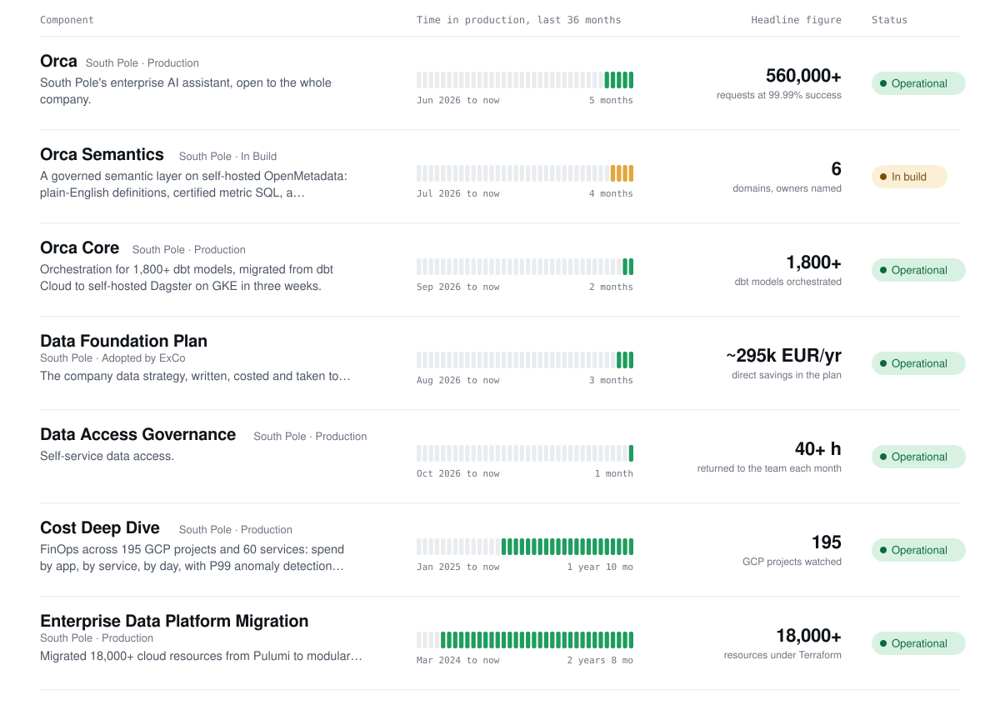
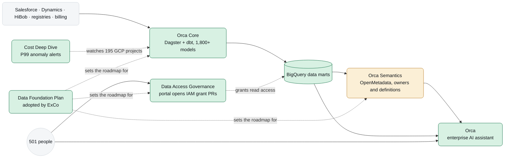

<a href="https://saahil.co.uk">
  <picture>
    <source media="(prefers-color-scheme: dark)" srcset="assets/banner-dark.svg">
    
  </picture>
</a>

**Saahil Mehta** · Associate Director, Data & Insights at [South Pole](https://www.southpole.com) · London

I lead a team of six and own the data platform, data marts and reporting for a 501-person climate solutions company, and I still ship the systems myself. The contribution graph under this README is the operator's own uptime. Full status page: **[saahil.co.uk](https://saahil.co.uk)**.

## Components

<a href="https://saahil.co.uk/projects">
  <picture>
    <source media="(prefers-color-scheme: dark)" srcset="assets/components-dark.svg">
    
  </picture>
</a>

Re-rendered every morning from <a href="https://saahil.co.uk/status.json">saahil.co.uk/status.json</a>, the same source the site builds from.

## How the systems fit together

Every query Orca runs executes as the signed-in person, so BigQuery IAM and policy-tag masking decide what each user sees; the semantic layer supplies meaning, never data.

## Release history

| Version | Role | Where | When |
|---|---|---|---|
| `v2026.07` | **Associate Director, Data & Insights** | South Pole | Jul 2026 to present |
| `v2024.03` | Lead Specialist, Data Engineering | South Pole | Mar 2024 to Jul 2026 |
| `v2023.07` | Senior Data Engineer II | Publicis Groupe, Digitas UK | Jul 2023 to Mar 2024 |
| `v2022.10` | Senior Data Engineer I | Publicis Groupe, Digitas UK | Oct 2022 to Jul 2023 |
| `v2021.08` | Senior Associate, Data Analytics Engineering | Publicis Groupe, Digitas Mumbai | Aug 2021 to Sep 2022 |
| `v2021.06` | Manager, Data and Technology | WPP, GroupM Mindshare | Jun 2021 to Oct 2021 |
| `v2020.12` | Senior Associate, Data Science | Publicis Groupe, Digitas Mumbai | Dec 2020 to Jun 2021 |
| `v2019.07` | Associate, Data Science | Publicis Groupe, Digitas Mumbai | Jul 2019 to Dec 2020 |

Release notes for each version: [saahil.co.uk/experience](https://saahil.co.uk/experience).

## Operator

| | |
|---|---|
| Direct reports | 6 (analytics engineers, analysts, data engineers) |
| People served | 501 |
| Data strategy | Data Foundation Plan, seven workstreams to 2028, adopted by ExCo, ~295k EUR/yr direct savings |
| Platform reliability | from an incident every two days to roughly one a month |
| Commits | daily, see the graph below |

## Community

Mentor at the [Data Science Festival](https://datasciencefestival.com) (Spring 2026 cohort). Volunteer at the Museum of English Rural Life, where an OCR and two-stage LLM pipeline turned nine years of handwritten visitor cards into searchable data and a report for the leadership team. Google Developer Specialist, invite-only programme.

## Stack

`GCP` `BigQuery` `Terraform` `Dagster` `dbt` `Airflow` `Cloud Run` `GKE` `Cloud SQL` `GitHub Actions` · `Python` `SQL` `TypeScript` · `LLM applications` `RAG` `MCP` `agents` `evals` · `OpenMetadata` `IAM` `policy tags` `FinOps`

## Machine-readable

[status.json](https://saahil.co.uk/status.json) · [resume.json](https://saahil.co.uk/resume.json) · [cv.md](https://saahil.co.uk/cv.md) · [llms.txt](https://saahil.co.uk/llms.txt)

## Subscribe to updates

[self@saahil.co.uk](mailto:self@saahil.co.uk) · [LinkedIn](https://www.linkedin.com/in/saahil-mehta) · [Book a 30-minute call](https://calendly.com/saahil_mehta/30min)
